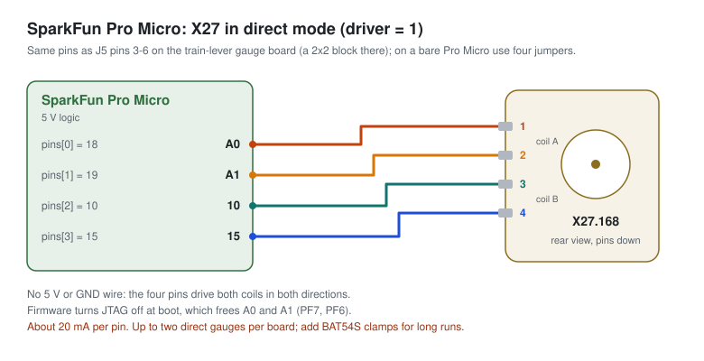
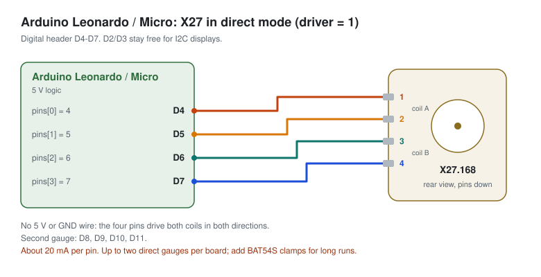
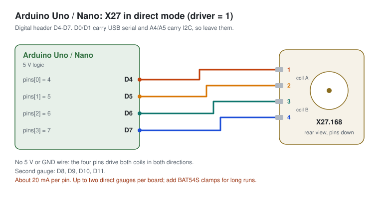
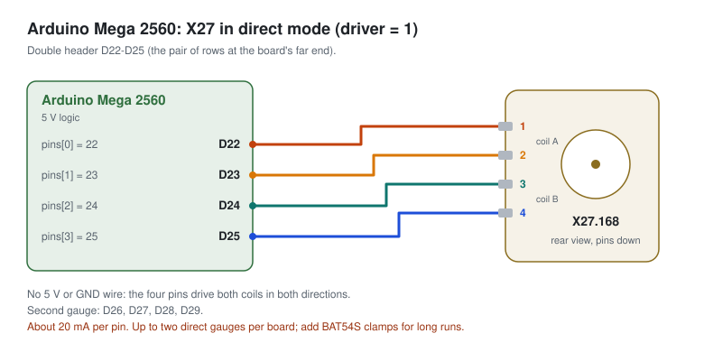
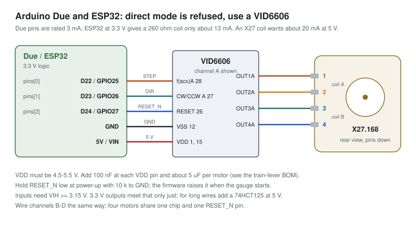
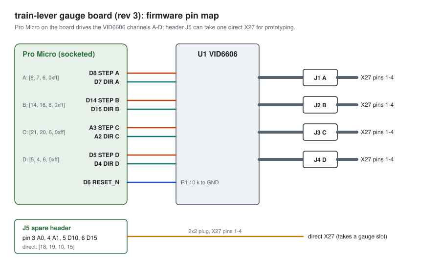

# Wiring X27 gauges

Firmware 3.3.0 drives X27.168 gauge steppers (and Switec X25/X27 clones) in two ways:

| Driver | Use it for | Pins per gauge | Boards |
|---|---|---|---|
| **VID6606** (`driver = 0`) | Anything you keep. The chip sequences the coils, microsteps at 1/12° and takes the coil current. | 2 (STEP, DIR), plus one RESET_N shared by the chip's four motors | All |
| **Direct** (`driver = 1`) | Quick prototypes on the bench: one motor, four jumper wires, no chip. | 4 | Pro Micro, Leonardo, Micro, Uno, Nano, Mega. **Not Due or ESP32.** |

The protocol fields are in [PROTOCOL.md](PROTOCOL.md#x27-gauge-module-type-7). The diagrams are generated by [wiring/make_diagrams.py](wiring/make_diagrams.py); edit the pin lists there, not the SVGs.

## Before you wire: find the coils

An X27.168 has four contacts in a row, numbered 1–4. Contacts 1–2 are one coil and 3–4 the other. Check this on each motor, because clones vary:

1. Measure between 1 and 2, then between 3 and 4, with a multimeter: about 230–290 Ω each.
2. Measure between 2 and 3: open circuit.

If your readings differ, renumber the contacts so that 1–2 and 3–4 are the two coils, and wire by those numbers.

## Direct mode

In direct mode the firmware switches four pins through the Switec six-state pattern. Each step is 1/3°, so a full 315° sweep is 945 steps. Both coils are energized in two of the six states and one coil in the other four. With about 20 mA per coil at 5 V, one gauge draws up to about 40 mA from the board's 5 V rail and each pin carries about 20 mA.

- **No power or ground wire goes to the motor.** The four pins drive both coils in both directions.
- **Two direct gauges per board at most.** Four would draw about 160 mA from the chip's VCC pins, close to the AVR's 200 mA limit.
- **Clamp diodes.** The X27 coils store little energy, and many projects drive them straight from AVR pins. That's fine on the bench. For anything left running, add a BAT54S (dual Schottky) on each pin, to 5 V and GND.
- The coils stay energized while the gauge is configured, so the needle holds its position. Removing the gauge in a new `Configure` switches the four pins low.

A direct gauge is configured with `pins` = the board pins wired to X27 contacts 1, 2, 3, 4, in that order.

### SparkFun Pro Micro



| X27 contact | 1 | 2 | 3 | 4 |
|---|---|---|---|---|
| Pro Micro pin | A0 | A1 | 10 | 15 |
| `pins[]` value | 18 | 19 | 10 | 15 |

These four pins are pins 3–6 of the spare header J5 on the [train-lever gauge board](#train-lever-gauge-board), where they form a 2×2 block (A0 and 10 on top, A1 and 15 below), so one 2×2 plug fits there. On a bare Pro Micro they sit in one row with 14 and 16 between 15 and 10, so use four separate jumper wires. The firmware turns JTAG off at boot, which A0 and A1 need. Second gauge on a bare Pro Micro: 4, 5, 6, 7. Those pins are used by the gauge board, so don't use them there.

Example `Configure` (one module, config_id 1, 945 steps, 1800 steps/s, 1500 steps/s²):

```
02 01 00 00 00 01 00 07   01 12 13 0A 0F B1 03 08 07 DC 05 00
```

### Arduino Leonardo and Micro



| X27 contact | 1 | 2 | 3 | 4 |
|---|---|---|---|---|
| Pin | D4 | D5 | D6 | D7 |

Second gauge: D8, D9, D10, D11. D2 and D3 are the I2C pins on these boards; keep them for displays.

### Arduino Uno and Nano



| X27 contact | 1 | 2 | 3 | 4 |
|---|---|---|---|---|
| Pin | D4 | D5 | D6 | D7 |

Second gauge: D8, D9, D10, D11. Leave D0/D1 (USB serial) and A4/A5 (I2C) free. The Uno and Nano have 2 KB of RAM; see [board limits](ARCHITECTURE.md#board-limits) before adding a matrix as well.

### Arduino Mega 2560



| X27 contact | 1 | 2 | 3 | 4 |
|---|---|---|---|---|
| Pin | D22 | D23 | D24 | D25 |

Second gauge: D26, D27, D28, D29.

### Arduino Due and ESP32: not supported



The firmware rejects `driver = 1` on these boards with `ConfigurationError`:

- **Due**: most pins are rated for 3 mA (15 mA on a few), against the ~20 mA an X27 coil draws at 5 V. Driving the coils would exceed the pin rating.
- **ESP32**: the pins could supply the current, but at 3.3 V a 260 Ω coil only gets about 13 mA, two-thirds of its rated current, and the X27 is specified from 5 V. Expect weak torque and lost steps with a real needle.

Use a VID6606 instead, wired as above:

- Power the VID6606 from 5 V (VDD 4.5–5.5 V), with 100 nF at each VDD pin and about 5 µF per motor.
- Its inputs need at least 3.15 V for a high level. 3.3 V outputs only just meet that; on long wires, put a 74HCT125 powered from 5 V between the board and the chip.
- Pull RESET_N to GND with 10 kΩ, so the chip stays in reset until the firmware raises it.

Configure each channel with `driver = 0` and `pins = [STEP, DIR, RESET_N, 0xff]`, for example `[22, 23, 24, 0xff]` on a Due or `[25, 26, 27, 0xff]` on an ESP32.

## VID6606 on any board

Each motor uses one VID6606 channel: STEP to `f(scx)`, DIR to `CW/CCW`, and the channel's OUT1–OUT4 to X27 contacts 1–4. Each STEP pulse is 1/12°, so a full 315° sweep is 3780 steps.

- `pins = [STEP, DIR, RESET_N, 0xff]`. Give every channel of one chip the same RESET_N pin: the first gauge to start holds it low for 2 ms and then high, and the others leave it alone. Use `0xff` if your board releases RESET_N some other way.
- Up to 5000 steps/s (about 417°/s). Above that, STEP pulses would come on consecutive 100 µs ticks, and each pulse has to be followed by a low gap.
- The datasheet says every STEP and DIR input must sit at a defined level, even on unused channels. The firmware drives only configured channels, and the train-lever board has no pull resistors on them, so **configure all four channels of a chip** (with or without a motor attached). If you can't spare the gauge slots, tie the unused STEP and DIR inputs to GND.

## train-lever gauge board

The [class323 gauge driver board](https://github.com/albertorestifo/train-lever/blob/main/docs/electronics/class323-gauge-driver/README.md) (revision 3) carries a socketed 5 V Pro Micro over a VID6606. Firmware 3.3.0 matches its pin map:



| Connector | Channel | STEP | DIR | `pins[]` |
|---|---|---|---|---|
| J1 | A | D8 | D7 | `[8, 7, 6, 0xff]` |
| J2 | B | D14 | D16 | `[14, 16, 6, 0xff]` |
| J3 | C | A3 | A2 | `[21, 20, 6, 0xff]` |
| J4 | D | D5 | D4 | `[5, 4, 6, 0xff]` |

- **RESET_N is D6** with R1 (10 kΩ) to GND on the board. Put 6 in `pins[2]` of every channel; the firmware pulses it once.
- **Gauge C works because the firmware turns JTAG off.** A3/A2 are PF4/PF5, the 32U4's JTAG TCK/TMS pins. Older firmware leaves them under JTAG control if the clone's fuses enable it.
- **A direct X27 on J5** (pins 3–6: A0, A1, D10, D15) fits alongside, wired as in the [Pro Micro section](#sparkfun-pro-micro). It takes one of the four gauge slots, so at most three VID6606 channels can be configured with it; tie the fourth channel's STEP and DIR to GND. The four-gauge limit stays until the timer interrupt's cost has been measured on hardware (see [verification](#hardware-verification)).
- D9, TX, RX, SDA and SCL on J5 stay free; SDA/SCL can take an HT16K33 display (fit its pull-ups).
- Example `Configure` for channel A alone (3780 steps, 5000 steps/s, 50000 steps/s²):

  ```
  02 01 00 00 00 01 00 07   00 08 07 06 FF C4 0E 88 13 50 C3 00
  ```

The board's own bring-up checks (VCC at J5 pin 1 at least 4.6 V with all four gauges sweeping, measuring the real steps per sweep) are in its [handoff](https://github.com/albertorestifo/train-lever/blob/main/docs/electronics/class323-gauge-driver/elements/gauge-driver/HANDOFF.md).

## Troubleshooting

| Symptom | Cause | Fix |
|---|---|---|
| Needle buzzes or jitters instead of turning | Coil pairs wired wrong | Re-check the coils with a meter. On the gauge board, swap the wires in positions 2 and 3 of that gauge's housing. |
| Needle turns the wrong way | Motor mounted the other way round | Set `flags` bit 0 (reverse) instead of rewiring. |
| Needle loses its place at speed | Speed or acceleration too high for the needle and dial | Lower `max_speed` first, then `acceleration`. Send `ZeroGauge` to recover. |
| Gauge C on the gauge board never moves | JTAG still on (firmware before 3.3.0) | Update the firmware. |
| VID6606 gauges never move | RESET_N held low | Check that `pins[2]` names the RESET_N pin, or that the board releases it. |
| `ConfigurationError` on a Due or ESP32 | `driver = 1` | Use a VID6606. |

## Hardware verification

None of this has been run on hardware yet. Before relying on it:

1. Pro Micro + VID6606 + one X27: watch the zero sweep at boot, then sweep full scale at increasing `max_speed` and `acceleration` until steps are lost. Record safe values.
2. The same with a direct X27 on J5 pins 3–6.
3. Toggle a spare pin around the timer interrupt and measure it on a scope, with four gauges moving and a matrix configured. Aim for under 30% of the 100 µs tick before raising the four-gauge limit.
4. Check that an HT16K33 display and a button matrix still behave while gauges move, and that a new `Configure` during a move re-zeros cleanly.
5. ESP32 with a VID6606: send a new `Configure` while a gauge moves. It must not crash: the flash write pauses the gauges.
